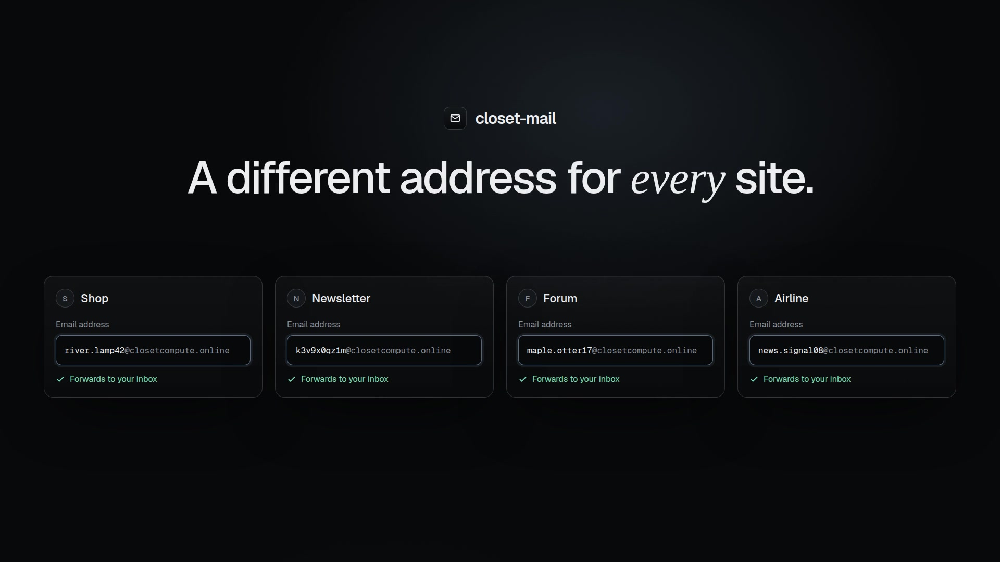

# closet-mail

A self-hosted email alias service in the style of addy.io, running on `closetcompute.online`.
It is run by an operator for the people they serve: each person gets a subdomain
(`acme.closetcompute.online`), every site gets its own address, mail is forwarded to their
real inboxes, and they can reply anonymously as the alias.

[](docs/media/closet-mail-demo.mp4)

## Features

- **Subdomains:** the operator creates one per person, with its own inboxes, aliases, catch-all, limits and daily send share. Suspend or retire it at any time.
- **Aliases:** random word or character aliases, custom aliases, subdomain aliases with optional catch-all, labels, bulk actions.
- **Forwarding:** to every ticked inbox, or to all default inboxes. A banner with one-click "block sender" and "disable alias" links, tracking-pixel removal, per-inbox PGP encryption.
- **Anonymous replies:** reply from your own inbox. The correspondent sees only the alias, and your address is removed from headers and body.
- **Protection:** Rspamd spam scoring with an encrypted quarantine, blocklists by address or domain, per-sender blocking.
- **Bounces:** every copy has its own Resend id, so webhooks and DSNs land on the exact inbox. An inbox is disabled after repeated hard bounces.
- **Metrics:** mail received, delivered, held and dropped per subdomain and per day; top sender domains, senders, aliases and inboxes; recent mail with the sender and every inbox it went to.
- **Status:** each subdomain's Cloudflare MX/SPF records, edge flag and inboxes are checked every 15 minutes.
- **Operator console:** only the operator signs in (TOTP and passkeys). Scoped API tokens per subdomain, health and dead-letter retry.
- **Operations:** data retention, health alerts by email, and nightly encrypted database backups to R2.

## How it works

```
Sender → Cloudflare Email Routing → edge Worker (KV check) → R2 + Queue
       → processor (home server, pulls over HTTPS) → Rspamd → transform → Resend SMTP → your inbox
```

- **Edge:** Cloudflare accepts mail only for known addresses, buffers it in R2 and queues a job. Mail waits there while the server is offline.
- **Server:** the processor pulls jobs, applies spam checks, blocking and rewriting, and sends through Resend.
- **Replies:** replies go to opaque `…@rp.closetcompute.online` addresses and come back out as the alias.
- **Dashboard and API:** served through a Cloudflare Tunnel, so the server opens no inbound ports.

## Layout

| Path | Contents |
|---|---|
| `backend/` | Python 3.12 package `mailalias`: FastAPI API, mail processor, Celery worker (uv-managed) |
| `edge/` | `edge-inbound` Cloudflare Email Worker (TypeScript, wrangler) |
| `web/` | Dashboard SPA (Vite, React 19, TypeScript, TanStack Query, shadcn/ui) |
| `landing/` | Public landing page for the apex domain (Astro, Tailwind, Motion, Magic UI), deployed to Cloudflare Pages |
| `deploy/` | Dockerfiles, production and dev compose files, Caddyfile, Rspamd config, deploy scripts |
| `docs/runbook.md` | Deploy, webhooks, backups and restore, monitoring |
| `SECURITY.md` | How to report a vulnerability |

## Development

Prerequisites: uv, Node 22+, Docker.

```sh
cp deploy/.env.example deploy/.env   # then fill in real values (chmod 600)
make dev-up                          # Postgres :5433, Redis :6380, Rspamd :11333
cd backend && uv sync && uv run pytest
cd backend && uv run uvicorn mailalias.api.app:create_app --factory --reload   # API on :8000
cd edge && npm ci && npm test
cd web && npm ci && npm run dev      # proxies the API on :8000
cd landing && npm ci && npm run dev  # landing page on :4321
```

The encryption, hash and signing keys have no defaults. For local work put dev values in `backend/.env`; generate a Fernet key with `uv run python -c 'from cryptography.fernet import Fernet; print(Fernet.generate_key().decode())'`. Don't run the processor or worker against the production queue from a dev machine.

| Task | Command |
|---|---|
| All tests | `make test` |
| Lint | `make lint` |
| Type-check | `make typecheck` |
| Migrate dev DB | `make migrate` |
| Regenerate web API types | `make api-types` |

## Deployment

CI publishes the production images to GHCR on every push to `main`. The server only pulls images: no source code is copied there. The landing page is a static site that CI publishes to Cloudflare Pages. See [`docs/runbook.md`](docs/runbook.md).

## Security

See [SECURITY.md](SECURITY.md) to report a vulnerability privately.

## License

[GNU Affero General Public License v3.0](LICENSE). If you run a modified version as a network service, you must offer its source to the service's users.

`backend/mailalias/data/wordlist.txt` is the EFF Short Wordlist, licensed CC BY 3.0 (Electronic Frontier Foundation).
